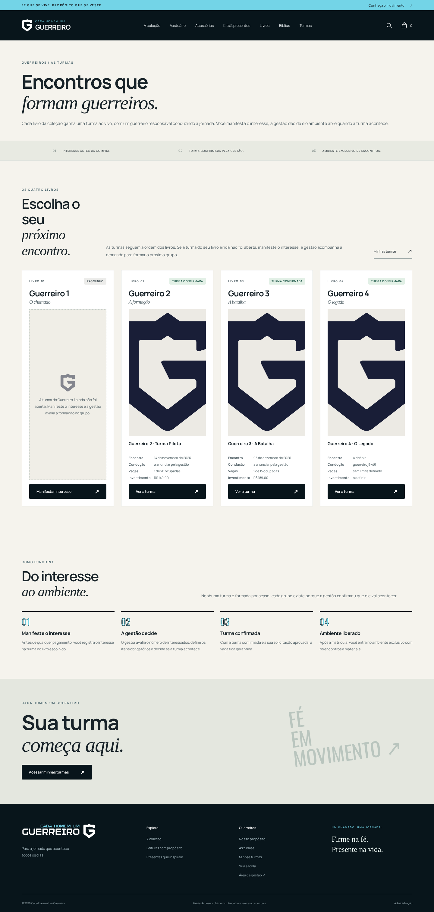
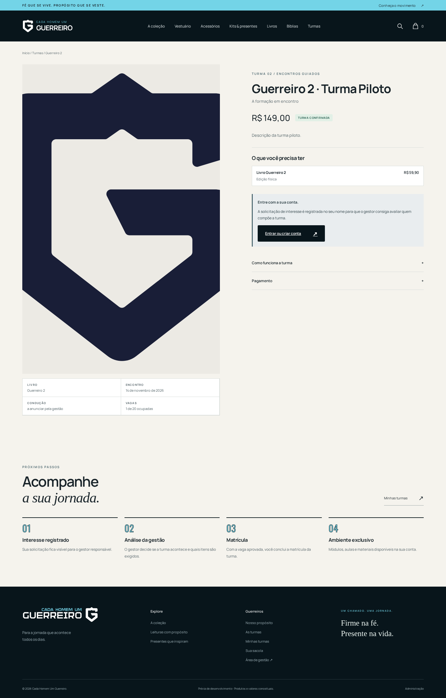
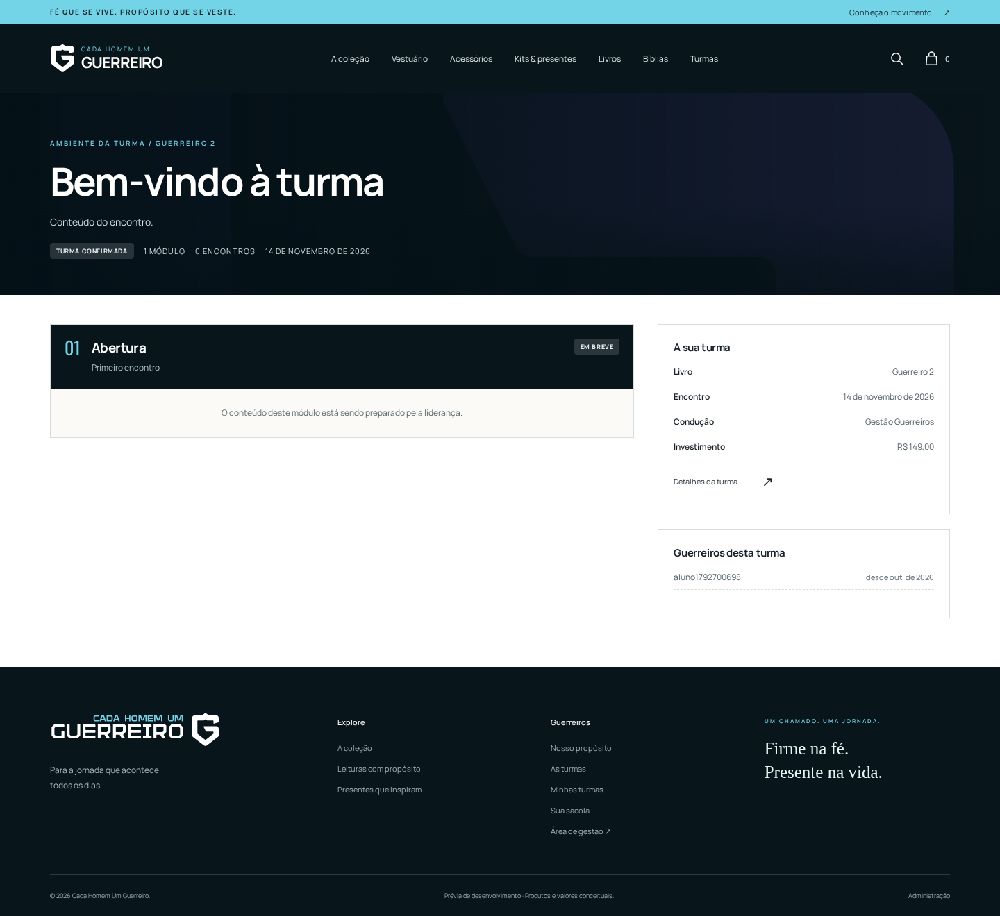
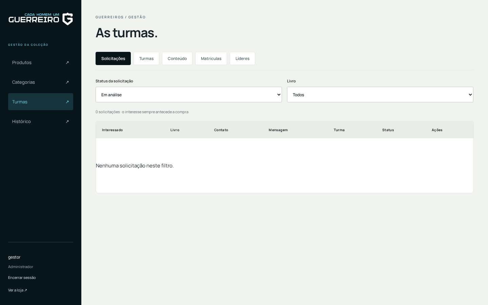
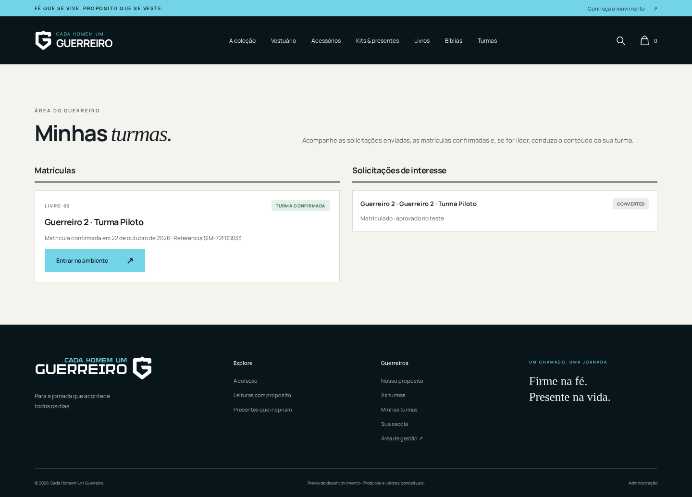
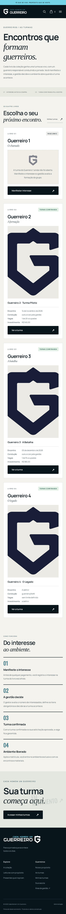

# Cada Homem um Guerreiro — Next.js + NestJS

Loja em React 19 / Next.js 16 (App Router), API NestJS 11 e TypeScript. Monorepo pnpm com contratos Zod compartilhados. Hospedagem e PostgreSQL próprios, sem serviços de banco terceirizados.

## Tecnologias

Python · JavaScript · TypeScript · React · Node.js · Next.js · Docker · Linux · SQL · PostgreSQL · Git · Astro · Java · n8n

O catálogo existente foi migrado: 22 produtos, cinco categorias, variações, galerias, preços, estoque e credenciais do administrador. A identidade visual, fontes locais e imagens foram mantidas. O checkout continua indisponível até a integração de pagamentos e frete.

## Telas

<table>
  <tr>
    <td width="50%"><b>Lista de turmas</b><br></td>
    <td width="50%"><b>Detalhe da turma</b><br></td>
  </tr>
  <tr>
    <td><b>Ambiente exclusivo do participante</b><br></td>
    <td><b>Painel do gestor supremo</b><br></td>
  </tr>
  <tr>
    <td><b>Minhas turmas (participante)</b><br></td>
    <td><b>Mobile</b><br></td>
  </tr>
</table>

## Visualizar localmente

A versão compilada está em **http://127.0.0.1:8000/** e o painel em **http://127.0.0.1:8000/admin/**. O usuário existente foi preservado; as credenciais locais continuam no arquivo privado `.local-admin.txt`.

```bash
source scripts/node-env.sh
pnpm install --frozen-lockfile
pnpm build
bash scripts/preview.sh
```

Pré-requisitos: Node.js 22 ou superior e pnpm 11.25.0. O script `node-env.sh` também encontra o runtime instalado neste computador. A API local escuta somente em `127.0.0.1:4187`; o navegador utiliza a origem do Next, na porta 8000.

Sem `DATABASE_URL`, o ambiente local usa SQL.js e persiste em `data/next-nest.sqlite`. Esse modo atende à prévia local; produção exige PostgreSQL. Não apagar `data/` nem `media/`, que contêm dados persistentes privados.

## Organização

- `apps/web`: loja, carrinho e painel administrativo em React/Next.js.
- `apps/api`: autenticação, catálogo, estoque, carrinho, mídia e administração NestJS.
- `packages/contracts`: tipos e validação dos contratos HTTP.
- `design/`: identidade, originais e peças gráficas; `apps/web/public/static/`: arquivos públicos da loja.
- `media/`: imagens enviadas pelo administrador.
- `docs/05-arquitetura-next-nest.md`: planejamento e decisões da arquitetura atual.
- `legacy/django/`: código e banco anteriores, preservados para consulta e reversão. Não participam da execução atual.

## Administração

Após o login, o painel permite cadastrar, editar e excluir produtos; configurar categoria, preços, estoque, publicação, destaques, variantes e imagens; organizar categorias e consultar o histórico de alterações. As mutações exigem sessão, origem permitida, CSRF e permissão no servidor. Preços são armazenados em centavos.

Para uma instalação vazia, criar o primeiro administrador com um arquivo privado contendo uma senha de 12 a 200 caracteres:

```bash
node apps/api/dist/auth/create-admin.js gestor /caminho/privado/senha.txt
```

O comando não imprime a senha e recusa sobrescrever usuários existentes. Nesta instalação, usar o administrador já migrado.

## Turmas (encontros presenciais)

Os quatro livros da coleção ganham turmas com encontros ao vivo. O fluxo completo está em `/turmas/`, no detalhe de cada turma (`/turma/<slug>/`) e no ambiente exclusivo (`/turma/<slug>/ambiente/`):

1. **Interesse antes da compra.** O interessado cria conta pelo próprio site (`/entrar/`, perfil `CUSTOMER`, senha mínima de 8 caracteres) e manifesta interesse com livro, contato e mensagem. Solicitações repetidas em análise ou aprovadas retornam `409`.
2. **Decisão da gestão.** Só o administrador supremo (`role === "ADMIN"` com permissão de gestão) decide: aprova ou rejeita solicitações, muda o status da turma (`DRAFT → OPEN → CONFIRMED`, `FINISHED`, `CANCELLED`), define preço, vagas, itens obrigatórios, líder e a configuração visual do ambiente.
3. **Compra.** A matrícula só é permitida com turma `CONFIRMED` e solicitação `APPROVED`; a reserva vira `CONFIRMED` no checkout simulado, que devolve uma referência no formato `SIM-XXXX` (testes locais; pagamentos reais ainda não estão integrados).
4. **Ambiente exclusivo.** Somente o participante matriculado (e a liderança/gestão) acessa os módulos, aulas e materiais; o link é privado e exige sessão.
5. **Liderança.** O gestor concede e revoga o privilégio de líder na aba Líderes. O líder cria e edita a turma, módulos e aulas, mas todo conteúdo nasce como rascunho: a publicação (`PUBLISHED`) e qualquer mudança de status, preço ou política são exclusivas da gestão.

O painel fica em `/admin/?aba=turmas`, com as sub-abas **Solicitações**, **Turmas**, **Conteúdo**, **Matrículas** e **Líderes**. O estúdio do líder fica em `/minhas-turmas/`.

A regra de negócio vive em `apps/api/src/turmas/` (serviço e rotas públicas `turmas` + administrativas `admin/turmas`), os tipos e schemas Zod em `packages/contracts/src/index.ts` e as páginas em `apps/web/src/app/(store)/turmas`, `(store)/turma/[slug]` e componentes `turmas*.tsx`. A migração `TurmasEncontros1792650000000` cria as oito tabelas (turmas, itens, solicitações, matrículas, módulos, aulas, configuração do ambiente e lideranças); no PostgreSQL aplicar as migrations antes de subir a API, e no SQL.js local a sincronização automática cria as tabelas na primeira execução.

## Migração dos dados existentes

A exportação privada e o backup consistente ficam em `data/migration/`. Eles contêm hashes de senha e dados de sessão: não publicar nem versionar. O importador é transacional e tem marcador de execução para impedir reimportação acidental.

```bash
source scripts/node-env.sh
pnpm migrate
pnpm import:legacy
```

O catálogo não é recriado automaticamente por seeds: restaurar a exportação privada e `media/` ao transportar esta loja. Para refazer a exportação do legado, com ele parado e suas dependências Python disponíveis: `.venv/bin/python scripts/export-django.py`. Não substituir o backup original nem importar dados antigos sobre alterações novas sem um plano de restauração.

Senhas Django PBKDF2 existentes continuam válidas. Contas novas usam scrypt. Sessões autenticadas antigas exigem novo login; carrinhos legados ainda válidos podem ser transferidos ao receber o cookie anterior. Tokens de sessão novos são opacos e apenas seus hashes são armazenados.

## Hospedagem própria

`Dockerfile`, `compose.yaml` e `deploy/Caddyfile` separam Next.js, NestJS, PostgreSQL 17 e proxy HTTPS. Somente Caddy publica portas 80/443; banco e API ficam nas redes internas. Os processos da aplicação usam usuário sem privilégios. O PostgreSQL não usa sincronização automática: aplicar migrations antes de iniciar a aplicação.

1. Copiar `.env.example` para `.env`, restringir permissões e preencher domínio, senhas independentes e `DATABASE_URL` com a senha codificada para URL. Configurar DNS e acesso HTTPS no servidor.
2. Executar `docker compose build` e `docker compose up -d db`.
3. Executar `docker compose run --rm api node apps/api/dist/database/migrate.js`.
4. Para esta loja, disponibilizar a exportação privada no container e executar o importador:

```bash
docker compose run --rm \
  -v "$PWD/data/migration:/app/data/migration:ro" \
  api node apps/api/dist/database/import.js
```

5. Transferir o conteúdo de `media/` para o volume `media_data`, preservando caminhos e permitindo escrita ao UID/GID 10001. Em uma instalação vazia, criar um administrador com o comando acima dentro do container, montando o arquivo de senha privado.
6. Executar `docker compose up -d` e homologar login, upload, carrinho, HTTPS e persistência após reinício.

Os containers e o PostgreSQL de produção precisam ser homologados no servidor: este computador não dispõe de Docker/PostgreSQL para executar essa etapa. A prévia validada usa o armazenamento local. O projeto não foi publicado na internet.

## Verificação e operação

```bash
source scripts/node-env.sh
pnpm typecheck
pnpm test
pnpm format:check
pnpm build
```

Os testes da API usam banco isolado e verificam autenticação, CSRF, origem, autorização, preços, estoque, variantes, administração, uploads, limitação de tentativas e o fluxo de turmas (interesse, aprovação, matrícula, checkout simulado e permissões de líder). `GET /api/v1/health` verifica a disponibilidade da API. Logs e PIDs da prévia ficam em `data/`.

Em produção, `bash scripts/backup.sh` gera dump PostgreSQL e cópia de mídia; cifrar, copiar para outro host e ensaiar a restauração. Para reverter a migração, parar a nova aplicação, restaurar o snapshot consistente anterior e sua mídia e subir o legado em ambiente isolado. Alterações feitas após o corte precisam ser conciliadas antes da reversão.

Python é utilizado apenas por ferramentas de exportação e criação de peças gráficas (`requirements-design.txt`); o site atual não depende de Django.
