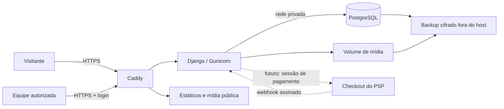

> Documento histórico da V1 Django. A arquitetura vigente e os critérios da migração estão em `05-arquitetura-next-nest.md` e no README da raiz.

# Guerreiros — arquitetura e plano de execução

Data: 22/10/2026. Estado: proposta técnica e base para a primeira versão, sem implantação em produção.

## 1. Objetivo e evidências

Criar uma loja de livros, Bíblias, vestuário, acessórios e kits da marca Cada Homem Um Guerreiro. A referência enviada mostra home, categoria, produto e experiência móvel. A pasta original contém somente PDF e EPS de estampas, sem aplicação existente, catálogo verificável, credenciais ou manual completo de marca. As peças serão referências visuais, não instruções operacionais. Valores, avaliações, estoque, descontos e promessas de frete da imagem não constituem dados comerciais confirmados.

Requisitos confirmados: infraestrutura e banco próprios; sem Supabase/Firebase; design moderno com personalidade; arquivos de identidade organizados; loja inicial e painel autenticado para cadastrar/configurar produtos.

## 2. Decisões arquiteturais

**Arquitetura inicial: monólito modular Django, templates renderizados no servidor, CSS próprio e JavaScript progressivo, PostgreSQL em produção, arquivos em volume próprio, Caddy como entrada HTTPS e Gunicorn como servidor.**

O painel, autenticação, sessões, permissões, formulários, CSRF e migrações aproveitam mecanismos maduros do Django. Isso reduz código de segurança artesanal, esforço de operação e dependência de serviços externos. A composição visual continua totalmente personalizada. React/Next.js é alternativa futura se a complexidade de interação justificar; as skills de React instaladas são opcionais. Não se adota Medusa como dependência: seus padrões de storefront são aproveitados independentemente do framework.

Desenvolvimento local pode usar SQLite próprio para demonstrar e testar rapidamente; produção exige PostgreSQL. Não haverá fallback silencioso para SQLite em produção. O ambiente deve recusar iniciar sem chave secreta, hosts e credenciais explícitos. PostgreSQL e mídia persistem fora do ciclo de vida dos contêineres.

| Camada | Responsabilidade | Limite |
|---|---|---|
| Caddy | HTTPS, reverse proxy, limite de upload, arquivos estáticos | Única entrada pública; aplicação não publica porta externa |
| Django | Vitrine, carrinho, validação, painel, permissões | Regra comercial executada no servidor |
| PostgreSQL | Catálogo, usuários, sessões, auditoria e pedidos futuros | Rede interna; credencial sem superusuário para aplicação |
| Volume de mídia | Imagens sanitizadas de produtos | Não executável, com backup e validação de upload |
| Checkout hospedado, futuro | Cartão/Pix e confirmação de pagamento | Adaptador externo; nenhum dado de cartão no banco |
| Worker, futuro | Webhooks, comunicação, conciliação | Fila persistente, tentativas e idempotência |

## 3. Escopo de entregas

### V1 construída nesta etapa

- Home editorial responsiva com identidade própria, categorias, coleção e lançamentos conceituais.
- Catálogo, busca, filtro de categoria, ordenação, detalhes e carrinho em sessão.
- Painel em `/admin/`, login, logout, produtos, categorias, variações, mídia, destaque e publicação.
- Preços em decimal, estoque não negativo e validação de imagem; produtos não publicados invisíveis na loja.
- Histórico administrativo, controle de acesso no servidor, proteção CSRF e limitação de tentativas de login.
- Migrações, dados de demonstração explicitamente identificados, testes e arquivos de implantação própria.

### Etapa de operação comercial

- Escolher PSP com suporte à operação brasileira; avaliar Pix, cartão, parcelamento, estorno, conciliação, suporte e taxas mediante proposta vigente.
- Integrar frete/transportadora, endereço, cotação, emissão fiscal/ERP, mensagens transacionais e política de troca.
- Implementar reservas de estoque, pedidos, cobrança, webhook e conciliação com testes de sandbox antes de aceitar compras.
- Configurar recuperação de senha por SMTP próprio, MFA administrativo ou acesso protegido por VPN/SSO, monitoramento e backups testados.

A V1 não deve simular cobrança bem-sucedida ou aceitar dinheiro sem essas integrações. A tela de carrinho deve informar claramente a indisponibilidade do checkout.

## 4. Módulos e propriedade de dados

- `config`: ambiente, rotas, middleware, WSGI e políticas transversais.
- `shop`: catálogo, variantes, imagens, carrinho e apresentação.
- Administração nativa com tema da marca: gerenciamento e auditoria.
- `payments`, `orders`, `shipping`: módulos posteriores, com contratos bem definidos.

| Entidade | Campos essenciais | Regras |
|---|---|---|
| Categoria | nome, slug, ordem | slug único |
| Produto | título, slug, SKU, descrição, categoria, preço, preço anterior, status, destaque, foto | SKU/slug únicos; preço positivo; anterior maior que atual quando informado |
| Variante | produto, SKU, nome, preço opcional, estoque | estoque inteiro não negativo; variante pertence ao produto |
| Imagem | produto, arquivo, alt, ordem | raster validado e reprocessado; sem SVG/HTML enviados |
| Usuário administrativo | credencial, ativo, equipe, permissões | sem cadastro público administrativo |
| Sessão | identificador opaco, expiração, carrinho | preço do carrinho sempre recalculado |
| Auditoria | ator, objeto, ação, data | administração registra inclusão, alteração e exclusão |
| Pedido futuro | cliente, endereço snapshot, itens snapshot, valores, status | valor em centavos/decimal; mudanças auditadas |
| Pagamento futuro | pedido, PSP, ID externo, estado, moeda | unicidade de evento e chave idempotente |
| Reserva futura | variante, quantidade, expiração | transação e bloqueio de linha; liberação idempotente |

Catálogo real só será publicado após revisão de imagens, direitos, preços, dimensões, pesos e estoque pela operação. O seed cria somente produtos conceituais, nunca usuários com senha conhecida.

## 5. Mapa da experiência

| Rota | Uso | Indexação |
|---|---|---|
| `/` | marca, coleção, categorias, produtos | pública |
| `/loja/` | busca, filtros e ordenação | página base pública; combinações arbitrárias não indexáveis |
| `/produto/{slug}/` | fotos, descrição, preço e variantes | produto publicado |
| `/carrinho/` | editar quantidade e remover | noindex |
| `/admin/` | acesso e gerenciamento | noindex; autenticação |
| `/sobre/` | propósito e identidade | pública |
| `/privacidade/` | transparência de dados | revisar antes de operação |
| `/saude/` | verificação mínima | sem detalhes internos |

Navegação principal com cinco categorias, busca e sacola; filtros em formulário usável sem JavaScript. Mobile com menu acessível e controles grandes. Compra sem cadastro será preferível na etapa comercial, com consulta a pedido por autenticação ou token de curta duração e escopo restrito.

## 6. Segurança por fronteira

Esta seção é análise preventiva da arquitetura proposta, não laudo de vulnerabilidades de código existente. A skill `security-threat-model` fica instalada para uma auditoria posterior ancorada na aplicação; não se afirma que um modelo formal foi executado.

| ID / risco | Caminho de abuso | Controle projetado | Evidência exigida para liberação |
|---|---|---|---|
| S01 / alto | alterar preço/variante no navegador | preço e vínculo calculados no servidor; esquema validado | teste de adulteração e variante de outro produto |
| S02 / alto | usuário lê pedido de outro | autorização por proprietário em toda consulta; negar por padrão | teste com duas contas; ID aleatório não substitui permissão |
| S03 / alto | login por força bruta | hash de senha do framework, limitação persistente, MFA/VPN antes de produção | teste de bloqueio; recuperação e revogação |
| S04 / alto | webhook falso marca pago | assinatura sobre corpo bruto, janela temporal, consulta ao PSP, idempotência | falsificação, replay e eventos fora de ordem |
| S05 / alto | duas compras do último item | transação e reserva atômica no PostgreSQL | teste concorrente contra PostgreSQL |
| S06 / alto | XSS por descrição/imagem | escape de templates; raster reprocessado; CSP; sem HTML livre | payload refletido/armazenado não executa |
| S07 / alto | CSRF altera catálogo | middleware CSRF, POST para mutações, SameSite e validação de origem | POST sem token recusado |
| S08 / alto | vazamento de segredo ou backup | segredos por arquivo/ambiente; volume privado; backup cifrado | scanner e restauração sem exposição |
| S09 / alto | invasão do host ou cadeia de dependências | menor privilégio, contêiner não root, lock, patches e firewall | revisão de imagem e dependências |
| S10 / médio | busca/upload exaure recursos | limites de corpo, quantidade, dimensões e paginação | entradas grandes recusadas |
| S11 / alto | cache revela carrinho/admin | páginas privadas sem cache compartilhado | teste entre duas sessões |
| S12 / médio | tag de marketing rouba dados | sem tags por padrão; inventário e aprovação de alterações | revisão de CSP e terceiros |

Obrigatório: HTTPS em produção; cookies Secure/HttpOnly/SameSite; sessão rotacionada no login; logout via POST; validação de redirecionamento; sem detalhes de exceção para clientes; queries parametrizadas pelo ORM; cabeçalhos nos estáticos e na aplicação. Proxy só pode afirmar HTTPS se a rede impedir acesso direto e remover cabeçalhos recebidos do cliente.

Uploads limitados a raster, 5 MB e 20 megapixels, decodificados e recodificados, nomes aleatórios. Não disponibilizar originais de impressão na pasta pública. Imagens públicas não podem conter dados de cliente. CPF/endereço não devem ir a logs ou analytics.

Checkout hospedado reduz exposição a dados de cartão, mas não elimina responsabilidade PCI. Confirmar escopo aplicável com adquirente/PSP. Autorização deve ocorrer no servidor e em cada operação, conforme [OWASP](https://cheatsheetseries.owasp.org/cheatsheets/Authorization_Cheat_Sheet.html); o [PCI SSC](https://www.pcisecuritystandards.org/faqs/is-a-merchant-website-still-in-scope-for-pci-dss-if-it-meets-all-the-criteria-for-saq-a/) esclarece o escopo do site mesmo com SAQ A.

## 7. Fluxo comercial futuro

1. Servidor recalcula preço, validade de cupom, estoque, frete e prazo; nunca recebe total como verdade do cliente.
2. Cria pedido pendente e reserva com expiração dentro de transação.
3. Solicita sessão ao PSP usando chave idempotente ligada à tentativa; permite apenas domínio de checkout conhecido.
4. Cliente paga no PSP. Retorno do navegador mostra pendência até confirmação; parâmetro de URL não comprova pagamento.
5. Webhook autenticado é persistido com identificador único; worker confirma valor, moeda, conta recebedora e pedido pelo PSP.
6. Transição de estado idempotente confirma pagamento e baixa estoque; outbox transacional agenda recibo e expedição.
7. Rotina de conciliação trata webhook perdido, Pix expirado, reembolso e chargeback. Eventos antigos não regridem estado.
8. Cancelamento libera reserva uma única vez; devolução só repõe estoque conforme inspeção e regra da operação.

Estados de pagamento e expedição separados; reembolso parcial não deve apagar o histórico de pagamento. Pedido e item guardam snapshot para manter prova do preço vendido.

## 8. Infraestrutura própria

Topologia inicial: host Linux atualizado com Caddy e aplicação; PostgreSQL em rede interna/volume próprio. Preferência por banco em host separado quando houver orçamento e equipe. Firewall expõe somente 80/443; SSH por VPN ou IP autorizado. Sem portas públicas de banco, cache ou Gunicorn. Usuário da aplicação não é superusuário do banco.

Separar dev, homologação e produção; nenhum dado real em demonstração. Segredos fora do Git, credenciais diferentes por ambiente e acesso de manutenção individual. Execução por usuário sem root; volumes de mídia e banco com permissões mínimas. Build reproduzível e inventário de versões. Migração executada como job único antes de trocar release; backup pré-migração e estratégia expand/contract.

Backup: meta proposta RPO 24h e RTO 4h para início, a validar com negócio. Dump diário cifrado, cópia de mídia e cópia externa ao host; retenção inicial 7 diários/4 semanais/6 mensais. Banco e mídia precisam de consistência temporal. Ensaio mensal de restauração em host isolado, documentando tempo e integridade. Evoluir para PITR/WAL quando o custo de perda justificar. Backup nunca fica em diretório público.

Monitorar disponibilidade, taxa de erros, latência, tentativas de login, disco, idade de backup e conexões. Alertas com responsável e canal definido antes de lançamento. Runbook: conter acesso, preservar evidências, revogar sessões/segredos, corrigir, restaurar quando necessário e validar integridade antes da reabertura.

## 9. Design, desempenho, descoberta e métricas

Direção completa em `02-identidade-visual.md`. Meta de acessibilidade WCAG 2.2 AA, foco visível, teclado, leitor de tela, redução de movimento e contraste medido. Metas de experiência: LCP <= 2,5 s, CLS <= 0,1 e INP <= 200 ms no percentil 75 após tráfego suficiente; medições locais são aproximações. Imagens responsivas, dimensões fixadas, WebP, carregamento tardio abaixo da dobra e fontes locais/licenciadas.

SEO: títulos únicos, URLs estáveis, canonical, sitemap apenas de publicados e breadcrumbs. Product/Offer apenas com dados verdadeiros; sem avaliações inventadas. Pesquisa e filtros arbitrários fora do índice. Descrições úteis por categoria e produto. Slug alterado após publicação exige redirecionamento permanente.

Métricas futuras: visualização de produto, adicionar/remover carrinho, início de checkout e compra confirmada no servidor com transaction_id para deduplicação. Sem nomes, e-mails, CPF ou endereço nos eventos. Consentimento e política de retenção precisam ser definidos pela operação antes de ativar tags. Nenhuma tag de anúncios instalada automaticamente.

## 10. Plano de execução e critérios

| Fase | Entrega | Critério de saída |
|---|---|---|
| 0 | planejamento e inventário | decisões, hipóteses e dados faltantes explícitos |
| 1 | kit visual | logo derivado do original, exportações, mockups conceituais e guia |
| 2 | vitrine e catálogo | mobile/desktop, navegação, busca, produto e carrinho funcionando |
| 3 | administração | usuário autorizado cria/edita/publica produto; anônimo recusado |
| 4 | operação comercial | PSP/frete/fiscal reais em sandbox e conciliação testada |
| 5 | homologação e implantação | restauração, revisão de segurança, MFA/VPN e monitoramento comprovados |

Testes prioritários: acesso anônimo/equipe sem permissão, CSRF, preço adulterado, produtos ocultos, imagem inválida, preço/estoque negativos, vínculo de variante, limites de carrinho, busca vazia, persistência de alteração administrativa e fluxo de logout. Na fase comercial: concorrência, replay e falha parcial. Build/check não demonstra segurança de produção.

## 11. Decisões pendentes e riscos

Antes de operação: domínio; sistema operacional e capacidade do host; responsável por patches e backup; orçamento; CNPJ e políticas; catálogo/fotos reais; pesos e medidas; provedor financeiro; transportadoras; ERP/fiscal; SMTP; regras de frete/Pix/parcelas; prazo de retenção; canal de alertas. Prosseguir no desenvolvimento com dados conceituais não aprova esses dados para venda.

As skills são auxiliares, não garantia de segurança ou qualidade. Instruções externas que conflitem com o escopo, a marca ou a infraestrutura própria não determinam decisões do projeto. Não se publicam assets sem revisão de direitos e fidelidade.

## 12. Base consultada

- Skills locais: frontend-design, storefront-best-practices, web-design-guidelines, site-architecture, seo-audit, schema, cro, copywriting, analytics, conversion-tracking, webapp-testing e security-best-practices.
- [Django deployment checklist](https://docs.djangoproject.com/en/5.2/howto/deployment/checklist/): configuração e validação de implantação.
- [OWASP Authorization](https://cheatsheetseries.owasp.org/cheatsheets/Authorization_Cheat_Sheet.html): menor privilégio e validação a cada requisição.
- [OWASP Transaction Authorization](https://cheatsheetseries.owasp.org/cheatsheets/Transaction_Authorization_Cheat_Sheet.html): integridade e execução autorizada.
- [PCI SSC — site em escopo](https://www.pcisecuritystandards.org/faqs/is-a-merchant-website-still-in-scope-for-pci-dss-if-it-meets-all-the-criteria-for-saq-a/): responsabilidades com pagamento terceirizado.
