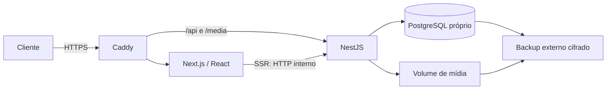

# Guerreiros — arquitetura React + Next.js + NestJS

22/10/2026. Este documento substitui a decisão Django do plano inicial. A identidade visual e os requisitos de infraestrutura própria permanecem.

## Decisão e fronteiras

Monorepo TypeScript com workspaces pnpm: `apps/web` (React, Next.js App Router), `apps/api` (NestJS sobre Express) e `packages/contracts` (tipos e validações Zod compartilhadas). A API é a única dona de regras comerciais e acesso ao banco. Next.js renderiza páginas no servidor e usa componentes clientes apenas para menu, sessão, galeria, sacola e formulários administrativos.

| Decisão | Escolha | Motivo e alternativa |
|---|---|---|
| Renderização | App Router e Server Components | Mantém catálogo no HTML inicial; evita carregar toda a loja como SPA |
| API | NestJS modular + REST `/api/v1` | Separa catálogo, sessão, carrinho, administração e mídia; GraphQL não traz benefício necessário nesta etapa |
| Persistência | PostgreSQL próprio + TypeORM | Mesmas entidades TypeScript na API; migrações explícitas; sem serviços de banco externos |
| Prévia local | SQLite próprio via sql.js | Permite prévia sem Docker/PostgreSQL instalado; ambiente de produção recusa este driver |
| Autenticação | Sessões opacas no banco | Revogação no servidor, cookie HttpOnly e ausência de tokens de acesso no localStorage |
| Contratos | Zod + TypeScript compartilhado | Validação em runtime na API, com erros previsíveis nos formulários React |
| UI | CSS e assets existentes, componentes React | Preserva o visual já aprovado sem introduzir um kit genérico ou trocar a identidade |
| Hospedagem | Caddy + contêineres Node + PostgreSQL | Infraestrutura própria, sem Supabase/Firebase; API e banco sem porta pública |

Localmente Next.js mantém a URL `http://127.0.0.1:8000`, encaminhando `/api/v1/*` e `/media/*` para NestJS em `127.0.0.1:4187`. Não existe dependência da API Python para renderizar, autenticar ou cadastrar produtos.

## Organização do código

- `apps/web/src/app`: rotas, layouts, metadados, loading e tratamento de erros.
- `apps/web/src/components`: Header/Footer, ProductCard, Gallery, compra, sacola e admin.
- `apps/web/src/lib`: cliente público do servidor, cliente autenticado do navegador e formatação monetária.
- `apps/api/src/database`: entidades, configuração e migrações.
- `apps/api/src/auth`: sessões, credenciais, proteção CSRF, papéis e limitação persistente de login.
- `apps/api/src/catalog`: catálogo público e consultas filtradas/paginadas.
- `apps/api/src/cart`: valores recalculados e integridade de produto/variação.
- `apps/api/src/admin`: gestão de produtos, categorias e auditoria.
- `apps/api/src/media`: upload validado e reprocessado.
- `packages/contracts`: schemas de entrada e interfaces de resposta. Nenhum segredo neste pacote.
- `data/`: banco local e exportação privada de migração, ignorados pelo Git.
- `legacy/django`: fontes anteriores para rastreabilidade e reversão; fora do runtime novo.

Não adotar microserviços por entidade, Kubernetes, cache distribuído ou fila antes de uma necessidade operacional comprovada. Pagamentos, frete e fiscal continuam fases futuras. O checkout permanece indisponível até integração real e homologação.

## Modelo e contratos

Preservar IDs do catálogo migrado para manter URLs e vínculos. Produto tem preço em centavos inteiros, categoria, slug/SKU únicos, publicação/destaque/conceito, timestamps e imagem. Variação e imagem adicional são entidades filhas normalizadas. Valores JSON da API usam centavos, formatados como BRL no front; o total nunca é aceito do navegador.

Sessão usa identificador aleatório de 256 bits; banco guarda apenas seu hash. Carrinho pertence à sessão e armazena produto, variação e quantidade. Consulta e mutação revalidam vínculo de variação, publicação, estoque e limites. Auditoria registra ator, objeto, operação e data. Contas administrativas têm papéis ADMIN/EDITOR; ações de catálogo exigem papel apropriado no servidor.

| API | Método e proteção | Responsabilidade |
|---|---|---|
| `/catalog/categories` | GET público | Categorias dinâmicas |
| `/catalog/products` | GET público | Busca, categoria, ordem, paginação e destaques |
| `/catalog/products/:slug` | GET público | Produto publicado e galeria; 404 para ocultos |
| `/session` | GET, cookie | Inicializar sessão e fornecer token CSRF e usuário mínimo |
| `/auth/login`, `/auth/logout` | POST + CSRF + origem | Login limitado e rotação/revogação de sessão |
| `/cart` | GET/POST/PATCH/DELETE | Carrinho em sessão; mutações com CSRF |
| `/admin/products` | GET/POST/PATCH/DELETE + papel | Listar inclusive rascunhos, cadastrar, editar e excluir |
| `/admin/categories` | GET/POST/PATCH/DELETE + papel | Gerenciar categorias e impedir exclusão em uso |
| `/admin/audit` | GET + papel | Histórico administrativo |
| `/media/upload` | POST + papel + CSRF | Raster até 5 MB e 20 megapixels, recodificado em WebP |
| `/health` | GET mínimo | Disponibilidade; sem configuração interna |

## Segurança e consistência

- API não confia em autorização feita pela interface. Sessão e papel são verificados em cada operação privada.
- Cookies HttpOnly, SameSite=Lax, Secure em HTTPS de produção; sessão rotacionada ao autenticar e encerrar. Sem JWT persistido no navegador.
- Mutações exigem origem exata permitida e token CSRF ligado à sessão, inclusive login. Sem CORS permissivo; navegador fala com o mesmo domínio.
- Senhas importadas do Django mantêm verificação PBKDF2 compatível; novas senhas usam scrypt com sal aleatório. Nenhum hash ou token sai nos DTOs de usuário.
- Limitação de login persistida no banco; respostas não revelam existência de usuário. MFA/VPN/SSO continua exigência operacional antes de exposição administrativa na internet.
- CSP com nonce por requisição para scripts de hidratação do Next.js; fontes e imagens locais. Rotas privadas sem cache compartilhado.
- Upload decodificado pelo Sharp, limitado por tamanho e pixels, nome aleatório e metadados descartados. Arquivos não executáveis. URLs de mídia limitadas a caminhos locais conhecidos.
- Zod rejeita campos desconhecidos; SKU/slug, preço anterior, estoque e variações são validados no servidor. ORM parametriza consultas.
- Transações para edição de produto/variantes/galeria e auditoria. Sem alterações parciais em caso de validação inválida. Banco impõe unicidade.
- Segredos só em ambiente/arquivos privados, sem prefixo público. Login, sessão, cabeçalhos e hashes não entram em logs.

## Plano de migração e preservação

1. Exportar o banco atual de verdade, não os seeds: categorias, 22 produtos (ou o total corrente), preços, imagens, variações, usuários administrativos, permissões efetivas e histórico.
2. Fazer backup SQLite consistente e exportação privada com permissões restritas. Copiar assets e preservar mídia.
3. Importar mantendo IDs e convertendo Decimal para centavos sem ponto flutuante. Registrar marca de importação para evitar duplicatas.
4. Carrinhos de sessões Django ainda válidas são importados por hash de cookie; a primeira visita troca o cookie pela nova sessão e mantém os itens. Não migrar autenticação privilegiada ativa: o usuário faz login novamente com a senha existente.
5. Construir a loja React e admin; validar os mesmos fluxos e comparar screenshots.
6. Compilar Next.js e NestJS, testar API, autorização, CSRF, login, upload, catálogo e carrinho; só depois trocar a porta 8000 para Next.js.
7. Arquivar fontes Django em `legacy/`, atualizar scripts e documentação. Nunca apagar o banco original ou arquivos enviados pelo usuário.

A exportação privada contém hashes de senha e dados operacionais: não entra no Git nem no diretório público. O arquivo `.local-admin.txt` permanece privado e sua senha continua válida se a conta correspondente existir na exportação.

## Infraestrutura, implantação e operação

Dois processos Node independentes; PostgreSQL em rede privada; Caddy como única entrada. Build reproduzível pelo lockfile. Imagens sem root, credenciais de bootstrap do banco separadas das credenciais da aplicação, volumes persistentes, health checks e encerramento gracioso. Migrações executadas em job único; `synchronize` desativado em produção. Backups de banco e mídia com restauração ensaiada; metas iniciais RPO 24h e RTO 4h a validar.

Para escalar, coordenar cache/artefatos do Next.js entre réplicas e usar identificador de implantação. Não colocar um cache público genérico na frente de admin, sessão ou carrinho. Primeiro medir latência e carga; adicionar Redis para necessidades reais de fila/cache, mantendo o banco como fonte de verdade.

Versões são consultadas no registro oficial e fixadas no lockfile. A homologação no host real continua necessária para Docker, PostgreSQL, DNS/TLS, permissões de volume, firewall, restore e SMTP. Ambiente local não equivale a uma certificação de produção.

## Critérios de aceite

- Mesmos caminhos públicos, mesma identidade e assets; busca, categorias e produtos publicados preservados.
- Totais migrados conferidos, sem perda dos seis produtos iniciais nem dos 16 adicionados da montagem.
- Admin em React com login, cadastro/edição/publicação, preços, estoque, variações, imagens e categorias; mutações negadas sem sessão/papel/CSRF.
- Senha atual funciona; logout revoga acesso; senhas não aparecem em respostas.
- Carrinho validado pelo back-end, com preço atual e proteção contra variação de outro produto.
- Build real dos dois aplicativos e prévia funcionando em `127.0.0.1:8000` sem Django.

## Referências primárias consultadas

- [Next.js self-hosting](https://nextjs.org/docs/app/guides/self-hosting)
- [Next.js Content Security Policy](https://nextjs.org/docs/app/guides/content-security-policy)
- [NestJS authentication](https://docs.nestjs.com/security/authentication)
- [NestJS database integration](https://docs.nestjs.com/techniques/database)
- [NestJS CSRF](https://docs.nestjs.com/security/csrf)
